

  

  
  
  
  
  
  
  

  <strong>Building useful systems where AI, software and hardware meet.</strong>

## What I Build

  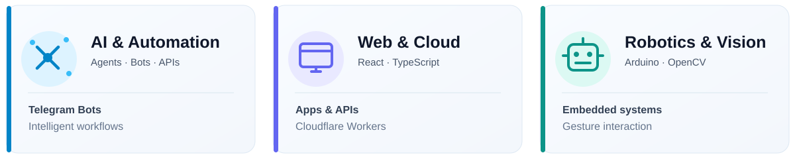

## GitHub Activity

  

## Projects by Category

<table width="100%">
<tr>
<th width="33%" align="center">Telegram &amp; AI</th>
<th width="33%" align="center">Robotics</th>
<th width="33%" align="center">Web &amp; Cloud</th>
</tr>
<tr>
<td width="33%" align="center" valign="middle"><a href="https://github.com/unesjami/AI-Powered-Content-Automation">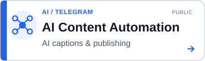</a></td>
<td width="33%" align="center" valign="middle"><a href="https://github.com/unesjami/Gesture-Interaction-Robot-GIR-">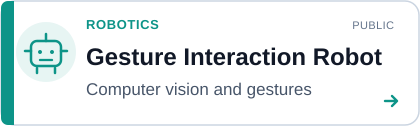</a></td>
<td width="33%" align="center" valign="middle"></td>
</tr>
<tr>
<td width="33%" align="center" valign="middle"><a href="https://t.me/PostOptimizeBot">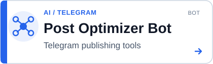</a></td>
<td width="33%" align="center" valign="middle"><a href="https://github.com/unesjami/Bluetooth-Controlled-Arduino-Car">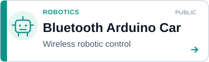</a></td>
<td width="33%" align="center" valign="middle"><a href="https://unesjami.github.io/TimeOS/">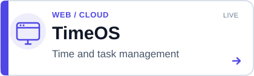</a></td>
</tr>
<tr>
<td width="33%" align="center" valign="middle">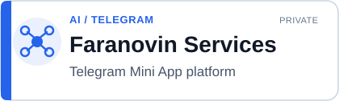</td>
<td width="33%" align="center" valign="middle">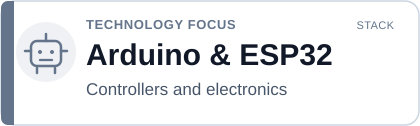</td>
<td width="33%" align="center" valign="middle"><a href="https://unesjami.github.io/Word-Update/">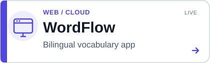</a></td>
</tr>
<tr>
<td width="33%" align="center" valign="middle">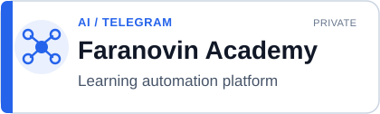</td>
<td width="33%" align="center" valign="middle">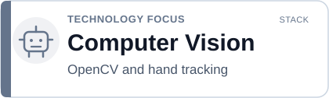</td>
<td width="33%" align="center" valign="middle"></td>
</tr>
<tr>
<td width="33%" align="center" valign="middle"></td>
<td width="33%" align="center" valign="middle">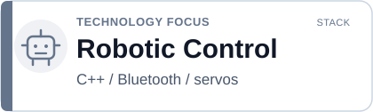</td>
<td width="33%" align="center" valign="middle">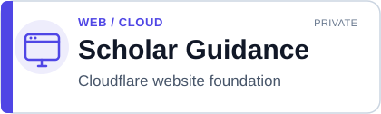</td>
</tr>
<tr>
<td width="33%" align="center" valign="top">Automation, Telegram bots and AI-powered digital products</td>
<td width="33%" align="center" valign="top">Robotics projects and engineering technologies</td>
<td width="33%" align="center" valign="top">Web applications, portfolio and Cloudflare infrastructure</td>
</tr>
</table>

PRIVATE = closed source · STACK = skills and technologies

<strong>Explore public source repositories</strong>

- [AI-Powered Content Automation](https://github.com/unesjami/AI-Powered-Content-Automation)
- [Gesture Interaction Robot](https://github.com/unesjami/Gesture-Interaction-Robot-GIR-)
- [Bluetooth-Controlled Arduino Car](https://github.com/unesjami/Bluetooth-Controlled-Arduino-Car)
- [TimeOS](https://github.com/unesjami/TimeOS)
- [Word Update / WordFlow](https://github.com/unesjami/Word-Update)

## Tech Toolbox

<strong>AI &amp; Automation</strong>

  
  

<strong>Web &amp; Cloud</strong>

  
  
  
  

<strong>Robotics &amp; Vision</strong>

  
  
  

<strong>More automation work</strong>

  
  
  

<strong>Build. Automate. Evolve.</strong>

