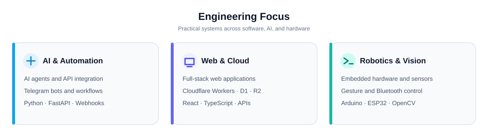

  

<h3 align="center">Building practical solutions across AI, software, automation, and robotics.</h3>

  
  
  
  
  
  

## About Me

I'm **Unes Jami**, an **AI Automation & Robotics Developer** and **Software Developer**. I build useful systems that bring together AI, APIs, modern web applications, Telegram automation, and embedded hardware.

My work spans designing digital products, developing backend services, integrating cloud infrastructure, and prototyping human–robot interaction. I also create digital solutions under **Faranovin** and contribute to independent client and team projects.

- **AI & automation:** AI-assisted content workflows, bots, APIs, webhooks, and integrations.
- **Software & web:** React/TypeScript applications, backends, databases, and Cloudflare deployments.
- **Robotics:** Arduino and ESP32, sensors, Bluetooth control, OpenCV, and hand-gesture interaction.
- **Product delivery:** Responsive UI, multilingual experiences, administration interfaces, and practical automation.

## Engineering Focus

  

## Technology Stack

**AI, automation & backend**

  

  
  
  
  

**Web, database & cloud**

  

  
  
  

**Robotics & computer vision**

  
  
  

## Selected Public Projects

| Project | What it demonstrates | Explore |
| --- | --- | --- |
| **Gesture Interaction Robot (GIR)** | Hand-gesture recognition, servo control, and real-time human–robot interaction. | [Repository](https://github.com/unesjami/Gesture-Interaction-Robot-GIR-) |
| **Bluetooth-Controlled Arduino Car** | Arduino electronics, Bluetooth communication, and a custom mobile controller. | [Repository](https://github.com/unesjami/Bluetooth-Controlled-Arduino-Car) |
| **AI-Powered Content Automation** | AI-generated image captions and automated Telegram publishing. | [Repository](https://github.com/unesjami/AI-Powered-Content-Automation) |
| **TimeOS** | Browser-based task and time management. | [Live demo](https://unesjami.github.io/TimeOS/) · [Repository](https://github.com/unesjami/TimeOS) |
| **Word Update / WordFlow** | English–Persian vocabulary learning web app. | [Repository](https://github.com/unesjami/Word-Update) |

## Selected Product & Client Work

> The projects below have **private source code**. These are high-level descriptions, not public repository links. Project status varies; listed work is not necessarily a completed public launch.

| Project | Scope |
| --- | --- |
| **Faranovin Services** | Telegram Mini App for a bilingual services catalog, orders, and admin-managed offerings (React, TypeScript, Cloudflare). |
| **Faranovin Academy Platform** | Configurable Telegram academy automation platform with subscription controls and Cloudflare infrastructure. |
| **Personal Portfolio Website** | English–Persian React portfolio with editable content, projects, services, and owner tools. |
| **Karyar Team Website** | Responsive, multilingual corporate and academy website with backend-managed content, forms, and administrative roles. |
| **Scholar Guidance** | Cloudflare Workers foundation for an upcoming website redesign; currently infrastructure-stage work. |
| **Afghanistan News Bot** | Automated news collection, deduplication, Dari summaries, and Telegram publishing. |
| **Post Optimizer Bot** | Telegram post composer with formatting, inline actions, saved posts, and scheduling. |
| **Telegram Moderation Tools** | Community onboarding, administrative controls, and moderation workflows. |

## Current Direction

- Building reusable AI and Telegram automation products that solve practical problems.
- Developing full-stack services and multilingual web experiences on Cloudflare.
- Expanding my skills in secure APIs, authentication, databases, and deployment pipelines.
- Continuing hands-on robotics and computer-vision projects.

<strong>Build. Automate. Evolve.</strong>

